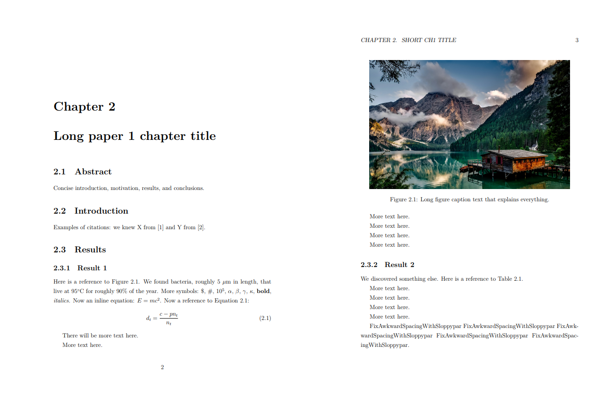

# Stanford LaTeX Thesis Example

## Preview

[View the latest PDF](https://github.com/dcroote/stanford-thesis-example/releases/latest/download/thesis-example.pdf) or click on the image below.

## About

The hope is that this example thesis saves you time that I and countless others before me spent on the minutiae of writing a thesis in LaTeX. It combines a slightly modified version (more on this below) of the existing [Stanford thesis style](https://web.stanford.edu/~emma/suthesis/suthesis-2e.sty) ([archived here](./2016-06-04-suthesis-2e.sty), [more Stanford information here](https://studentservices.stanford.edu/my-academics/earn-my-degree/graduate-degree-progress/dissertations-and-theses/prepare-your-work-0)) with a template for including figures, tables, inline references, equations, symbols, a bibliography, a signature page, etc...
I used this style as the basis for my (officially completed) thesis and thus believe it adheres to Stanford's policies, but I make no guarantees.

### Submitting through Axess

Keep the title page in the PDF you upload to Axess. The template's default setting (`\onlinetrue` in `suthesis-2e.sty`) leaves out the copyright page and the entire signature page. The abstract starts on page iv because [Stanford adds pages ii and iii to the library copy](https://studentservices.stanford.edu/my-academics/earn-my-degree/graduate-degree-progress/dissertations-and-theses/prepare-your-work-0#orderandcontent). Uncomment `\onlinesignature` in `main.tex` only if you want a signature page for a personal printed copy.

If you're a Ph.D., J.S.D., D.M.A., or Engineer student, email each reader to request approval. Stanford’s [reader approval instructions](https://studentservices.stanford.edu/my-academics/earn-my-degree/graduate-degree-progress/dissertations-and-theses/how-submit-your) include a sample email you can use and explain how to upload each reader’s reply to the Reading Committee Signature Page Sign Off eForm in Axess. The form is due two days before the thesis submission deadline. See Stanford's [dates for your quarter](https://studentservices.stanford.edu/my-academics/earn-my-degree/graduate-degree-progress/dissertations-and-theses#deadlines) and [submission checklist](https://studentservices.stanford.edu/my-academics/earn-my-degree/graduate-degree-progress/dissertations-and-theses/submit-your/checklist).

### Structure

This template adopts a modular structure where each chapter is a separate `.tex` file that is included by `main.tex`. Figures are similarly organized by publication or project. Citing references requires a bibliography in BibTeX format, which can be generated by exporting an existing collection from a reference manager such as [Mendeley](https://blog.mendeley.com/2012/03/24/how-to-series-generate-bibtex-files-for-your-collections-for-use-in-latex-part-3-of-12/), F1000, etc...

## Usage

1. Install LaTeX on your system, use a [Docker image](https://hub.docker.com/r/dxjoke/tectonic-docker), or use an online service like [Overleaf](https://www.overleaf.com/edu/stanford#overview). I used Overleaf because compilation is fast and simple.
2. Clone / download this repository, and if you are using an online service, upload the files.
3. Read `main.tex` and update it with your information. Add your bibliography, figures, and chapter text. There should be no need to further modify the Stanford style file `suthesis-2e.sty`.
4. Finish and submit thesis.

## Contributions

Pull requests are welcome for improvements or additions that will benefit others.

## Testing

This example thesis is compiled with [GitHub Actions](https://github.com/dcroote/stanford-thesis-example/actions), specifically the [GitHub Action for LaTex](https://github.com/marketplace/actions/github-action-for-latex) containing a full TeXLive environment.
